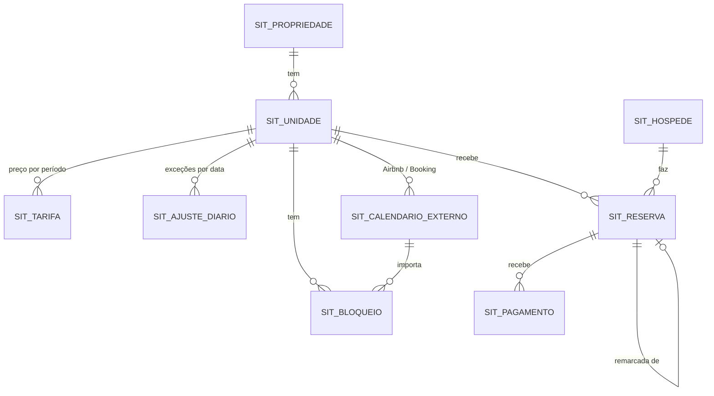

# Banco de dados de reservas — proposta v3 (atualizada em 18/11/2026)

Estrutura para o site responder, ao clicar em **Ver disponibilidade**, se o chalé está livre nas datas escolhidas e quanto custa a estadia, noite a noite, e para o hóspede **fazer a reserva** pelo site.

**O que o site faz e o que fica fora dele** (definido em 18/11/2026):

| No site | Fora do site (equipe) |
|---|---|
| Consultar disponibilidade e preço | Entrar em contato com o hóspede depois da reserva |
| Fazer a reserva: segurar as datas por 30 minutos, preencher os dados e o documento, aceitar a política e confirmar | Combinar e receber o pagamento (sinal e saldo) e lançá-lo em `SIT_PAGAMENTO` |
| | Cancelar, remarcar e demais alterações da reserva |

O site **não cobra** nada hoje: não há Pix automático, cartão nem integração com gateway. A tabela `SIT_PAGAMENTO` já está pronta para isso: quando o Mercado Pago (ou outro meio de pagamento online) for integrado, a cobrança entra como `TP_PROVEDOR = MERCADO_PAGO`, nasce `PENDENTE` com o id da transação e o aviso do provedor (webhook) a muda para `RECEBIDO`, sem mudar nenhuma tabela.

**Situação:** proposta em validação, ainda não ligada ao site. O schema roda num PostgreSQL 16 e passou em todos os testes desta pasta. Os dados iniciais usam os valores definidos em 16 e 17/11/2026: chalé Casa do Mirante, check-in 15h, casal R$ 800 de domingo a quinta e R$ 1.700 sexta, sábado e feriados, criança de 5 a 8 anos 30% e de 9 a 13 anos 100% do valor por pessoa, até 4 anos não paga mas ocupa vaga, mínimo de 2 noites (feriado prolongado 3, Réveillon e Carnaval 4), até 2 adultos e 2 crianças, até 7 noites, sinal não reembolsável com remarcação, reserva pelo site com 30 minutos para concluir, pagamento combinado depois pela equipe.

| Arquivo | Conteúdo |
|---|---|
| `schema.sql` | Tabelas, regras, funções e segurança |
| `seed_exemplo.sql` | Dados iniciais reais: a pousada, o chalé e a tarifa padrão |
| `testes.sql` | 96 verificações, no schema `"SE"`, de preço, faixas de idade, feriados, regras de venda, ocupação, pré-reserva, confirmação pelo site, pagamento lançado pela equipe, remarcação, cancelamento e documento do hóspede (cria os próprios dados de teste) |
| `exemplos_der.sql` / `exemplos_der.json` | Linhas fictícias mostradas no DER, aprovadas por todas as regras |
| `exportar_estrutura.sql` / `exportar_exemplos.sql` / `gerar_der.py` | Extraem a estrutura e os exemplos do banco e geram o `der.html` |
| `testes_permissoes.sql` | O que o visitante anônimo pode e não pode fazer |
| `remover_se.sql` | Apaga o banco do site inteiro (schema `"SE"` e agendamento do pg_cron), para recriar do zero com `schema.sql` e `seed_exemplo.sql`. Apaga também reservas e pagamentos |
| `remover_public.sql` | Apaga a primeira versão criada no schema `public` (tabelas, funções e agendamento), antes de criar tudo no `"SE"` |
| `supabase_simulado.sql` | Recria as permissões padrão do Supabase num PostgreSQL comum, só para os testes |

---

- **Sinal da reserva:** opções em aberto (QR Code Pix, WhatsApp automático, Mercado Pago) em [`OPCOES_SINAL.md`](OPCOES_SINAL.md).

## Por que Supabase

O app de vistorias (`solar-inspect`) já especifica Supabase (PostgreSQL, Auth, RLS, RPC e Edge Functions). Usar o mesmo banco evita duas bases para a mesma pousada, e a proposta reaproveita o modelo **Propriedade → Unidade** de lá. Assim, quando a vistoria bloquear um chalé por manutenção, esse bloqueio pode tirar as datas da venda no site.

O site continua estático no GitHub Pages: ele chama o banco direto pela API do Supabase.

O Supabase roda **PostgreSQL**, não Microsoft SQL Server. Os dois usam a linguagem SQL, mas o schema desta pasta usa recursos próprios do PostgreSQL: intervalos de datas (`daterange`) e a constraint que impede duas reservas na mesma noite. Em SQL Server essas duas partes teriam de ser reescritas com triggers.

## Modelo

Nomes no mesmo padrão dos outros projetos (esquema IBP): tabelas e campos em MAIÚSCULAS. **Toda tabela deste projeto começa com `SIT_`** (de Site), para separar das tabelas de outros projetos que usam o mesmo banco, como o `solar-inspect`, mesmo quando elas se integram. Tabelas no singular e prefixo pelo tipo do campo (`ID_` identificador, `NM_` nome, `DS_` descrição, `DT_` data, `HR_` hora, `VL_` valor, `QTDE_` quantidade, `NO_` número, `CD_` código, `TP_` tipo de lista fixa, `SG_` sim/não). Restrições com o nome completo da tabela: `PK_SIT_RESERVA`, `FK_SIT_RESERVA_SIT_UNIDADE` (`FK_<FILHA>_<PAI>`), `UQ_`, `CK_`, `EX_`, `IX_`, `TG_`. Os campos não levam o prefixo: a chave continua `ID_RESERVA`, `ID_UNIDADE` etc.

**Schema `"SE"` e nomes em maiúsculas de verdade** (18/11/2026): tudo fica no schema `"SE"`, e tabelas, campos, restrições e índices são criados entre aspas, então aparecem em MAIÚSCULAS no Supabase. Em qualquer SQL escrito à mão use aspas: `select "VL_TOTAL" from "SE"."SIT_RESERVA";` (sem aspas o PostgreSQL procura `sit_reserva` e não acha). As funções que o site e as Edge Functions chamam ficam em minúsculas (`consultar_disponibilidade`, `criar_pre_reserva`, `confirmar_reserva`), e os campos que elas devolvem também (`vl_total`, `disponivel`…), como a API espera.



O diagrama completo, com todos os campos, exemplos e regras de cada tabela, está em `der.html` (abre no navegador; ao clicar numa tabela aparece o detalhe dela).

| Tabela | Para que serve |
|---|---|
| `SIT_PROPRIEDADE` | A pousada: fuso, horários de check-in/out, faixas de idade das crianças (até 4, 5 a 8, 9 a 13), estadia máxima, percentual do sinal, minutos para pagar, regra de remarcação, prazo de arrependimento e versão da política de cancelamento |
| `SIT_UNIDADE` | Cada chalé: capacidade (hóspedes, adultos, crianças de todas as idades) e taxa de limpeza |
| `SIT_TARIFA` | Preço por período (`DT_INI`/`DT_FIM`): valor da noite, valor de sexta/sábado, adultos inclusos, adulto extra, percentual por criança de 5 a 8 anos (30%), de 9 a 13 anos (100%) e até 4 anos (0%) sobre o valor por pessoa, mínimo de noites. Períodos podem se sobrepor; vale o maior `NO_PRIORIDADE` |
| `SIT_AJUSTE_DIARIO` | Exceção de um dia (`DT_REF`): preço especial, mínimo de noites, noite fechada, sem chegada ou sem saída. Campo vazio não muda nada; o valor do ajuste substitui só o valor base da noite, e criança e bebê continuam vindo da tarifa (passo a passo no DER) |
| `SIT_RESERVA` | Reservas feitas no site (ou por telefone e contato direto): adultos e crianças por faixa de idade, preço noite a noite, sinal e saldo gravados no momento da reserva, aceite da política, motivo do cancelamento (inclusive `SEM_PAGAMENTO`) e a reserva original de uma remarcação |
| `SIT_PAGAMENTO` | Pagamentos da reserva (`TP_PARCELA`: SINAL, combinado depois da reserva; SALDO, no check-in). Hoje só lançamentos `MANUAL` da equipe, com método, comprovante e quem lançou; pronta para pagamento online (`MERCADO_PAGO`: `PENDENTE` → `RECEBIDO`) |
| `SIT_BLOQUEIO` | Datas indisponíveis que não são reservas do site: manutenção, uso próprio e reservas do Airbnb/Booking |
| `SIT_CALENDARIO_EXTERNO` | Links iCal do Airbnb e do Booking, importados periodicamente para `SIT_BLOQUEIO` |
| `SIT_HOSPEDE` | Nome, contato e documento da FNRH: CPF para brasileiro; passaporte, país emissor e validade para estrangeiro |

## Como a disponibilidade e o preço são calculados

A estadia são as **noites** de `DT_CHECKIN` até a véspera de `DT_CHECKOUT`. A noite do dia de saída não é cobrada nem ocupada, então quem sai no dia 21 libera o chalé para quem entra no dia 21.

Para cada noite da estadia:

1. **Preço da noite:** o ajuste do dia, se houver. Senão, a tarifa de maior prioridade que cobre a noite: valor de sexta/sábado nas noites de sexta e sábado, valor normal nas demais.
2. **Hóspedes:** o valor da noite cobre os adultos inclusos (o casal). Cada criança soma um percentual do valor por pessoa da noite (valor da noite ÷ adultos inclusos): 5 a 8 anos 30%, 9 a 13 anos 100%; até 4 anos não paga, mas ocupa uma vaga de criança. Cada adulto além dos inclusos soma o valor de adulto extra.
3. **Total:** soma das noites + taxa de limpeza (uma vez por estadia).

A unidade fica **indisponível** quando ocorre qualquer um destes motivos, que voltam para o site mostrar a mensagem certa:

| Motivo | Quando |
|---|---|
| `datas_invalidas` | Check-out igual ou anterior ao check-in |
| `data_passada` | Check-in antes de hoje (fuso de São Paulo) |
| `estadia_longa` | Mais noites que o máximo da propriedade (7) |
| `capacidade` | Mais hóspedes, adultos ou crianças (todas as idades somadas) que o chalé comporta |
| `sem_tarifa` | Alguma noite sem tarifa cadastrada (venda ainda não aberta) |
| `fechado` | Alguma noite marcada como fechada |
| `sem_chegada` / `sem_saida` | Check-in ou check-out numa data que não permite |
| `min_noites` | Menos noites que o mínimo. Vale o **maior** mínimo entre as noites da estadia: quem entra antes do Réveillon e atravessa a virada também cumpre o mínimo do Réveillon |
| `ocupado` | Sobrepõe reserva confirmada, pré-reserva ainda válida ou bloqueio |

## Como o site usa

### 1. Consultar (botão "Ver disponibilidade")

Função pública `consultar_disponibilidade(check-in, check-out, adultos, crianças de 5 a 8, até 4 anos, crianças de 9 a 13)`, chamada direto do navegador:

```js
const resp = await fetch(`${SUPABASE_URL}/rest/v1/rpc/consultar_disponibilidade`, {
  method: 'POST',
  headers: {
    apikey: SUPABASE_ANON_KEY,
    Authorization: `Bearer ${SUPABASE_ANON_KEY}`,
    'Content-Type': 'application/json',
    'Content-Profile': 'SE',          // as funções estão no schema "SE"
  },
  body: JSON.stringify({ p_checkin: '2027-03-04', p_checkout: '2027-03-07', p_adultos: 2, p_criancas: 1, p_bebes: 0 }),
});
const [chale] = await resp.json();
```

O calendário usa `consultar_precos(início, fim, adultos, crianças de 5 a 8, até 4 anos, crianças de 9 a 13)`, que devolve uma linha por noite (`dt_ref`, `vl_noite`, `livre`) para até 62 noites; com hóspedes acima da capacidade não devolve nada.

Com a biblioteca `supabase-js`: `supabase.schema('SE').rpc('consultar_disponibilidade', { p_checkin: '2027-03-04', … })`. O schema `SE` precisa estar liberado em **Project Settings › API › Exposed schemas**.

Resposta de exemplo, gerada pelos testes (casal + 1 criança, 3 noites de qui a dom):

```json
{
  "cd_unidade": "casa-do-mirante", "nm_unidade": "Casa do Mirante",
  "disponivel": true, "motivo": null, "qtde_noites": 3, "qtde_min_noites": 1,
  "vl_hospedagem": 6000.00, "vl_taxa_limpeza": 0.00, "vl_total": 6000.00,
  "vl_medio_noite": 2000.00, "vl_sinal": 3000.00,
  "ds_detalhe": [
    { "dt_ref": "2027-03-04", "nm_tarifa": "Tarifa padrão", "vl_base": 1700.00, "vl_extras": 300.00, "vl_noite": 2000.00 },
    { "dt_ref": "2027-03-05", "nm_tarifa": "Tarifa padrão", "vl_base": 1700.00, "vl_extras": 300.00, "vl_noite": 2000.00 },
    { "dt_ref": "2027-03-06", "nm_tarifa": "Tarifa padrão", "vl_base": 1700.00, "vl_extras": 300.00, "vl_noite": 2000.00 }
  ]
}
```

Quando a unidade está indisponível, os valores vêm vazios e `motivo` explica o porquê. A API devolve os campos da consulta em minúsculas (`vl_total`, `disponivel`), como declarados na função. A chave `anon` do Supabase é pública por natureza; a proteção está no banco (ver Segurança).

### 2. Reservar

Duas chamadas, sempre por uma **Edge Function** do Supabase (nunca direto do navegador, para aplicar captcha e limite de tentativas):

1. `criar_pre_reserva(unidade, check-in, check-out, adultos, crianças de 5 a 8, até 4 anos, crianças de 9 a 13)` — quando o hóspede escolhe as datas, segura o chalé por **30 minutos** enquanto ele preenche a reserva, e devolve o código (ex.: `SE-7F3A2C1D`), o total e o sinal.
2. `confirmar_reserva(código, nome, e-mail, telefone, nacionalidade, CPF ou passaporte…)` — quando ele conclui o formulário: grava o hóspede (ou atualiza, se o e-mail já existe), com o documento, os acompanhantes e o aceite da versão vigente da política. A reserva **segue `PENDENTE`** até o fim dos 30 minutos, e a tela mostra o QR Code e o Pix copia e cola do sinal (identificador = código da reserva sem o hífen). O banco recusa se a pré-reserva já venceu (`pre_reserva_expirada`), se não está mais pendente (`reserva_nao_pendente`) ou se o passaporte do estrangeiro vence antes da saída.

3. `confirmar_sinal(código, quem conferiu, id do Pix)` — a equipe confere o Pix no extrato e roda no SQL Editor, por exemplo `select * from "SE".confirmar_sinal('SE-7F3A2C1D', 'Ana', 'E1234...');`. Lança o sinal em `SIT_PAGAMENTO` e deixa a reserva `CONFIRMADA`. Se o Pix chegou depois do prazo, só confirma se as datas continuarem livres (senão recusa com `ocupado`, e o valor é devolvido). Para ver os dados de uma reserva, use `consultar_reserva.sql`.

Se o hóspede não pagar em 30 minutos, a pré-reserva vence sozinha: a consulta já ignora pré-reservas vencidas, e um job (`expirar_pre_reservas`, via pg_cron) só atualiza o status.

**Outros pagamentos (fora do site):** sinal por outro meio ou saldo no check-in são lançados em `SIT_PAGAMENTO` (`TP_PROVEDOR = MANUAL`: Pix, cartão, dinheiro ou transferência, com quem lançou e o comprovante). O saldo é lançado no check-in. Se o hóspede não pagar, a equipe cancela a reserva com o motivo `SEM_PAGAMENTO`, e as datas voltam para a venda.

### 3. Airbnb e Booking

O chalé também é vendido nesses canais, então os três calendários precisam conversar:

- **Entrada:** um job (Edge Function agendada, a cada 15–30 min) lê o iCal de cada canal em `SIT_CALENDARIO_EXTERNO` e grava as datas em `SIT_BLOQUEIO`. O UID de cada evento permite atualizar ou remover o bloqueio quando o canal cancela.
- **Saída:** uma Edge Function publica um iCal com as reservas confirmadas e os bloqueios manuais, para ser importado no Airbnb e no Booking (o site estático não gera esse arquivo sozinho).

O iCal tem atraso de minutos a horas, então ainda existe um risco pequeno de vender a mesma data em dois canais nesse intervalo. Eliminar esse risco por completo exige um channel manager (integração por API).

## Garantias contra overbooking

- **No banco:** uma constraint impede duas reservas ativas do mesmo chalé na mesma noite, mesmo com acessos simultâneos.
- **Na pré-reserva:** a função trava o chalé durante a verificação, então pedidos simultâneos entram em fila. Testado com duas sessões ao mesmo tempo: a segunda esperou a primeira e foi recusada com `ocupado`.
- **Bloqueios fora da constraint:** ficam de fora de propósito, porque o iCal de um canal costuma devolver também as datas que o próprio site vendeu, e isso não pode quebrar a sincronização. A trava da pré-reserva cobre esse caso.

## Segurança

- **RLS em todas as tabelas,** sem nenhuma política para visitante: o navegador não lê nem grava tabela alguma. Testado como `anon`: 0 linhas em `SIT_RESERVA`, `SIT_HOSPEDE` e `SIT_PAGAMENTO`, inserção recusada.
- **Só duas portas para o visitante:** `consultar_disponibilidade` e `consultar_precos` (preço por noite do calendário), que não devolvem dados de hóspedes nem de outras reservas.
- **Revogação explícita:** no Supabase as funções novas recebem permissão de execução para `anon` e `authenticated` por padrão, então o schema revoga essa permissão papel a papel. A pré-reserva, a confirmação e a função interna de cálculo só rodam com `service_role`.
- **Equipe:** as políticas de acesso do painel (para cadastrar tarifas e ver reservas) entram junto com o login do Supabase, no mesmo modelo de perfis do `solar-inspect`.

## Decisões

Definidas em 16 e 17/11/2026 e já aplicadas: chalé Casa do Mirante; check-in às 15h e check-out às 12h; casal R$ 800 de domingo a quinta e R$ 1.700 sexta e sábado (regra de 20/11/2026); feriados prolongados a R$ 1.700 com mínimo de 3 noites, Réveillon e Carnaval 4 (`SIT_AJUSTE_DIARIO`, carregados no seed até o Réveillon 2028); criança de 5 a 8 anos paga 30% e de 9 a 13 anos 100% do valor por pessoa da noite; adulto a partir de 14 anos; criança até 4 anos não paga (`SIT_TARIFA.PC_BEBE` = 0, idade em `SIT_PROPRIEDADE.NO_IDADE_MAX_BEBE`), mas ocupa uma das 2 vagas de criança (as três faixas somam contra `SIT_UNIDADE.QTDE_MAX_CRIANCAS`); até 2 adultos e 2 crianças; sem taxa de limpeza; até 7 noites; mínimo de 2 noites; sinal de 50%, não reembolsável, com possibilidade de remarcação, combinado e recebido pela equipe depois da reserva; saldo pago no check-in, antes de entrar; 30 minutos para o hóspede concluir a reserva no site; aceite da política e motivo do cancelamento registrados em cada reserva; prazo de arrependimento de 7 dias (CDC art. 49).

Proposta aguardando aprovação: remarcar até 7 dias antes do check-in (`QTDE_DIAS_LIMITE_REMARCACAO`), crédito válido por 12 meses (`QTDE_MESES_VALIDADE_CREDITO`), diferença paga se a nova data for mais cara e não devolvida se for mais barata.

Propostas aguardando aprovação (detalhadas no dicionário de dados, com fontes): política de cancelamento (devolução integral em até 7 dias da reserva, remarcação sem custo com 7+ dias de antecedência, retenção do sinal ou de 20% do total na desistência sem remarcar) e tarifa dinâmica por regras (fator por tipo de data, desconto de antecedência, piso e teto; tabelas TIPO_DATA, DATA_ESPECIAL e REGRA_ANTECEDENCIA ainda não criadas).

Documento do hóspede (18/11/2026): a FNRH digital é obrigatória desde 20/04/2026 e pede o documento de cada hóspede. `SIT_HOSPEDE` ganhou `SG_NACIONALIDADE` (padrão BR), `CD_CPF`, `CD_PASSAPORTE`, `SG_PAIS_PASSAPORTE`, `DT_EMISSAO_PASSAPORTE` (opcional) e `DT_VALIDADE_PASSAPORTE`. Brasileiro exige CPF válido (dígitos verificadores conferidos pela função `cpf_valido`); estrangeiro exige passaporte com o país emissor e a validade (depois da emissão). O gatilho `TG_SIT_RESERVA_PASSAPORTE` recusa reserva ativa de estrangeiro cujo passaporte vence antes da saída. CPF único; passaporte único por país. O CPF **não** é a chave: `ID_HOSPEDE` continua como número interno, porque estrangeiro não tem CPF, a pré-reserva nasce antes do documento e a chave é copiada para outras tabelas (LGPD). O documento é exigido quando o hóspede é cadastrado, isto é, no fechamento da reserva.

Diagrama: `der.html` nesta pasta (abre no navegador). Para gerar de novo depois de mudar o schema:

```bash
psql -d solar -v ON_ERROR_STOP=1 -f exemplos_der.sql
```

```bash
psql -d solar -q -At -f exportar_estrutura.sql > schema.json
```

```bash
psql -d solar -q -At -f exportar_exemplos.sql > exemplos_der.json
```

```bash
python3 gerar_der.py schema.json der.html exemplos_der.json --completo
```

Use um banco de teste: `exemplos_der.sql` grava dados fictícios. O `gerar_der.py` confere se as ligações do desenho são as FKs reais e se cada campo tem explicação e exemplo.

## Como testar localmente

Com PostgreSQL 15+ e um banco vazio:

```bash
psql -d solar -v ON_ERROR_STOP=1 -f supabase_simulado.sql -f schema.sql -f seed_exemplo.sql
```

```bash
psql -d solar -v ON_ERROR_STOP=1 -f testes.sql -f testes_permissoes.sql
```

Cada cenário imprime `ok` ou interrompe com `FALHOU` mostrando o valor obtido e o esperado.

## Como aplicar no Supabase

1. **Só se você já rodou a versão antiga no `public`:** abra **SQL Editor › New query**, cole `remover_public.sql` e clique em **Run**. Ele apaga as tabelas `sit_…`, as funções e o agendamento do pg_cron da primeira versão; a conferência no fim deve mostrar `0 | 0`.
2. **New query** › cole `schema.sql` › **Run**. Cria o schema `"SE"` com as 9 tabelas, as funções, o RLS e as permissões. O Supabase pode avisar que a consulta mexe com permissões: confirme.
3. **New query** › cole `seed_exemplo.sql` › **Run** (a pousada, a Casa do Mirante e a tarifa padrão).
4. **Project Settings › API › Exposed schemas**: acrescente `SE` e salve. Sem isso o site não consegue chamar a consulta.
5. Para expirar pré-reservas automaticamente, ative **Database › Extensions › pg_cron** e rode:
   `select cron.schedule('expirar-pre-reservas', '* * * * *', 'select "SE".expirar_pre_reservas()');`
6. Conferência no SQL Editor: `select cd_unidade, disponivel, qtde_noites, vl_total, vl_sinal from "SE".consultar_disponibilidade('2027-03-02', '2027-03-04', 2, 1, 0);` deve trazer `casa-do-mirante | true | 2 | 4000.00 | 2000.00`. No Table Editor, escolha o schema `SE` no seletor do topo para ver as tabelas em maiúsculas.

**Recriar do zero** (ex.: depois de mudar o schema, antes de ter reservas reais): rode `remover_se.sql`, depois `schema.sql` e `seed_exemplo.sql`. O `seed_exemplo.sql` pode rodar mais de uma vez sem duplicar.

Num projeto de produção não rode `testes.sql` nem `exemplos_der.sql` (gravam dados fictícios); use um projeto de teste. Não rode `supabase_simulado.sql` no Supabase: os papéis `anon`, `authenticated` e `service_role` já existem lá.

## Publicar a função de reserva (`supabase/functions/reservar`)

A página `reserva.html` envia o pedido para uma Edge Function que segura as datas (`criar_pre_reserva`) e grava o cadastro (`confirmar_reserva`); a página mostra então o Pix do sinal. Ela usa a chave de serviço, que o Supabase injeta sozinho: essa chave nunca vai para o site nem para o GitHub. Enquanto a função não estiver publicada, a página cai no envio por e-mail.

1. **Banco atualizado.** A reserva ganhou `DS_ACOMPANHANTES`; se o seu banco foi criado antes disso, recrie: `remover_se.sql`, `schema.sql`, `seed_exemplo.sql` (só antes de ter reservas reais).
2. **Publicar.** Pelo painel: **Edge Functions › Deploy a new function › Via Editor**, nome `reservar`, com os arquivos `index.ts` e `handler.ts` da pasta `supabase/functions/reservar`, e **desligue "Verify JWT"** (o hóspede não faz login). Ou pela linha de comando: `supabase functions deploy reservar --no-verify-jwt --project-ref tnjpyjbqcjrowzjfnuln`.
3. **Segredos** (**Edge Functions › Secrets**): `ALLOWED_ORIGINS` = `https://alvesbhz.github.io` (endereços do site, separados por vírgula). Opcional, contra robôs: `TURNSTILE_SECRET` (Cloudflare Turnstile, gratuito); com ele, coloque a chave pública do Turnstile em `TURNSTILE_SITEKEY` no `reserva.html`.
4. **Conferir** que a função responde (não grava nada, o pedido vazio é recusado):
   `curl -s -X POST https://tnjpyjbqcjrowzjfnuln.supabase.co/functions/v1/reservar -H "Origin: https://alvesbhz.github.io" -H "Content-Type: application/json" -d "{}"` deve devolver `{"erro":"validacao","mensagem":"Confira os dados: ..."}`.
5. **O que ela faz e recusa:** valida datas (2 a 7 noites), hóspedes, CPF, passaporte válido até a saída e nome e sobrenome dos adultos; recusa datas ocupadas na hora (`409`); limita 6 tentativas por IP por hora; ignora robôs que preenchem o campo escondido; só aceita pedidos vindos de `ALLOWED_ORIGINS`.
6. **Avisar a equipe:** a função não envia e-mail. Quem reserva vê o código e um botão para avisar a pousada pelo WhatsApp; a equipe acompanha as novas reservas na tabela `SIT_RESERVA` (**Table Editor**, schema `SE`, status `CONFIRMADA` sem pagamento em `SIT_PAGAMENTO`).

Testes da função: `supabase/functions/reservar/teste.mjs` (19 verificações contra um PostgreSQL de teste com o schema `"SE"`).

## Próximos passos sugeridos

1. Fechar as decisões em aberto e substituir os dados de exemplo.
2. Criar o projeto no Supabase (ou usar o do `solar-inspect`) e aplicar o schema.
3. Ligar o botão "Ver disponibilidade" do site à consulta e mostrar preço ou motivo.
4. Importação dos iCal e exportação do iCal (Edge Functions). A tela de reserva e a função `reservar` já existem; falta publicá-la no Supabase.
5. Painel da equipe para tarifas, ajustes, reservas e lançamento de pagamentos.
6. Envio da FNRH digital ao Ministério do Turismo a partir do cadastro do hóspede.
7. Quando quiser cobrar online: Edge Function que cria a cobrança no Mercado Pago (`SIT_PAGAMENTO` `PENDENTE`) e recebe o aviso de aprovação; o banco já tem os campos e as regras.

- **Segurança (20/11/2026):** `migracao_seguranca.sql` acrescenta ao banco já criado (sem apagar dados) o limite de pedidos por visitante (`SIT_TENTATIVA`, `registrar_tentativa`, `pre_reserva_em_aberto`), as fotos dos documentos (`SIT_DOCUMENTO`, `registrar_documentos`), o registro automático de alterações (`SIT_AUDITORIA`) e as travas do `confirmar_sinal` (id do Pix e valor obrigatórios; valor menor que o sinal e id repetido são recusados). Depois rode `storage.sql`, que cria o bucket **privado** `documentos`. As fotos ficam em Storage › documentos › código da reserva, visíveis só para quem entra no painel do Supabase. Para ver alterações: `select * from "SE"."SIT_AUDITORIA" order by "DT_CRIACAO" desc;`
- `listar_hospedes.sql`: todos os cadastros de hóspedes com o resumo das reservas de cada um (quantas, confirmadas, aguardando sinal, total confirmado, códigos).
- `listar_reservas.sql`: todas as reservas com situação (aguardando sinal, vencida, confirmada, cancelada…), titular, contato, valores, sinal e saldo recebidos, quanto falta receber e tempo para pagar.
- `consultar_reserva.sql`: todos os dados de uma pré-reserva ou reserva numa linha (código, datas, hóspedes, valores, prazo, titular, acompanhantes, preço noite a noite e pagamentos). Rode no SQL Editor com o código entre as aspas; vazio mostra a pré-reserva mais recente.
- **20/11/2026, preços novos:** diária, faixas de idade e feriados mudaram a estrutura (`SIT_TARIFA.PC_*`, `SIT_RESERVA.QTDE_CRIANCAS_MAIORES`, parâmetro `p_criancas_maiores`). Recrie o banco: `remover_se.sql` → `schema.sql` → `seed_exemplo.sql`.
