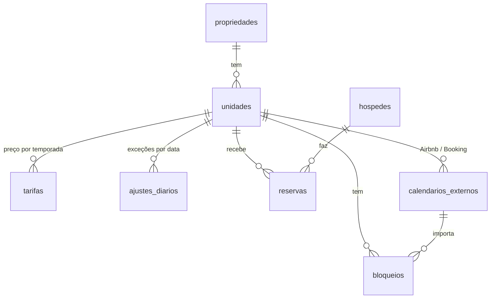

# Banco de dados de reservas — proposta v1

Estrutura para o site responder, ao clicar em **Ver disponibilidade**, se o chalé está livre nas datas escolhidas e quanto custa a estadia, noite a noite.

**Situação:** proposta para revisão, ainda não ligada ao site. O schema roda num PostgreSQL 16 e passou em todos os testes desta pasta. Os preços e temporadas de exemplo são fictícios.

| Arquivo | Conteúdo |
|---|---|
| `schema.sql` | Tabelas, regras, funções e segurança |
| `seed_exemplo.sql` | Dados fictícios: 1 chalé, temporadas, um bloqueio do Airbnb, uma reserva |
| `testes.sql` | 26 cenários de preço, regras de venda, ocupação e pré-reserva |
| `testes_permissoes.sql` | O que o visitante anônimo pode e não pode fazer |
| `supabase_simulado.sql` | Recria as permissões padrão do Supabase num PostgreSQL comum, só para os testes |

---

## Por que Supabase

O app de vistorias (`solar-inspect`) já especifica Supabase (PostgreSQL, Auth, RLS, RPC e Edge Functions). Usar o mesmo banco evita duas bases para a mesma pousada, e a proposta reaproveita o modelo **Propriedade → Unidade** de lá. Assim, quando a vistoria bloquear um chalé por manutenção, esse bloqueio pode tirar as datas da venda no site.

O site continua estático no GitHub Pages: ele chama o banco direto pela API do Supabase.

O Supabase roda **PostgreSQL**, não Microsoft SQL Server. Os dois usam a linguagem SQL, mas o schema desta pasta usa recursos próprios do PostgreSQL: intervalos de datas (`daterange`) e a constraint que impede duas reservas na mesma noite. Em SQL Server essas duas partes teriam de ser reescritas com triggers.

## Modelo



| Tabela | Para que serve |
|---|---|
| `propriedades` | A pousada: fuso, horários de check-in/out, idade máxima de criança pagante, estadia máxima |
| `unidades` | Cada chalé: capacidade (hóspedes, adultos, crianças) e taxa de limpeza. O site mostra um chalé hoje; o modelo aceita vários |
| `tarifas` | Preço por temporada: valor da noite em dia de semana e em sexta/sábado, hóspedes inclusos, valor de adulto e criança extra, mínimo de noites. Temporadas podem se sobrepor; a de **maior prioridade** vence (ex.: Réveillon por cima da Alta temporada, que fica por cima da Base) |
| `ajustes_diarios` | Exceção de um dia: preço especial (feriado), mínimo de noites, noite fechada, sem chegada ou sem saída naquela data |
| `reservas` | Reservas do site, telefone ou contato direto. Guarda o preço calculado no momento da reserva, para que mudanças de tarifa não alterem reservas já feitas |
| `bloqueios` | Datas indisponíveis que não são reservas do site: manutenção, uso próprio e reservas vindas do Airbnb/Booking |
| `calendarios_externos` | Links iCal do Airbnb e do Booking, importados periodicamente para `bloqueios` |
| `hospedes` | Nome, e-mail e telefone; só o necessário (LGPD) |

## Como a disponibilidade e o preço são calculados

A estadia é o intervalo de **noites** `[check-in, check-out)`. A noite do dia de saída não é cobrada nem ocupada, então quem sai no dia 21 libera o chalé para quem entra no dia 21.

Para cada noite da estadia:

1. **Preço da noite:** o ajuste do dia, se houver. Senão, a tarifa de maior prioridade que cobre a noite: valor de sexta/sábado nas noites de sexta e sábado, valor normal nas demais.
2. **Hóspedes extras:** acima dos hóspedes inclusos na tarifa, soma o valor de adulto e de criança extra por noite. Os adultos ocupam primeiro as vagas incluídas. Crianças abaixo de 2 anos não contam.
3. **Total:** soma das noites + taxa de limpeza (uma vez por estadia).

A unidade fica **indisponível** quando ocorre qualquer um destes motivos, que voltam para o site mostrar a mensagem certa:

| Motivo | Quando |
|---|---|
| `datas_invalidas` | Check-out igual ou anterior ao check-in |
| `data_passada` | Check-in antes de hoje (fuso de São Paulo) |
| `estadia_longa` | Mais noites que o máximo da propriedade (exemplo: 30) |
| `capacidade` | Mais hóspedes, adultos ou crianças que o chalé comporta |
| `sem_tarifa` | Alguma noite sem tarifa cadastrada (venda ainda não aberta) |
| `fechado` | Alguma noite marcada como fechada |
| `sem_chegada` / `sem_saida` | Check-in ou check-out numa data que não permite |
| `min_noites` | Menos noites que o mínimo. Vale o **maior** mínimo entre as noites da estadia: quem entra antes do Réveillon e atravessa a virada também cumpre o mínimo do Réveillon |
| `ocupado` | Sobrepõe reserva confirmada, pré-reserva ainda válida ou bloqueio |

## Como o site usa

### 1. Consultar (botão "Ver disponibilidade")

Função pública `consultar_disponibilidade(check-in, check-out, adultos, crianças)`, chamada direto do navegador:

```js
const resp = await fetch(`${SUPABASE_URL}/rest/v1/rpc/consultar_disponibilidade`, {
  method: 'POST',
  headers: {
    apikey: SUPABASE_ANON_KEY,
    Authorization: `Bearer ${SUPABASE_ANON_KEY}`,
    'Content-Type': 'application/json',
  },
  body: JSON.stringify({ p_checkin: '2027-03-04', p_checkout: '2027-03-07', p_adultos: 3, p_criancas: 0 }),
});
const [chale] = await resp.json();
```

Resposta de exemplo, gerada pelos testes (3 adultos, 3 noites de qui a dom):

```json
{
  "unidade": "chale-solar", "nome": "Chalé Solar",
  "disponivel": true, "motivo": null, "noites": 3, "min_noites": 1,
  "valor_hospedagem": 3520.00, "taxa_limpeza": 180.00,
  "valor_total": 3700.00, "valor_medio_noite": 1173.33,
  "detalhe": [
    { "data": "2027-03-04", "tarifa": "Base 2026–2027", "valor_base": 890.00,  "extras": 150.00, "valor": 1040.00 },
    { "data": "2027-03-05", "tarifa": "Base 2026–2027", "valor_base": 1090.00, "extras": 150.00, "valor": 1240.00 },
    { "data": "2027-03-06", "tarifa": "Base 2026–2027", "valor_base": 1090.00, "extras": 150.00, "valor": 1240.00 }
  ]
}
```

Quando a unidade está indisponível, os valores vêm vazios e `motivo` explica o porquê. A chave `anon` do Supabase é pública por natureza; a proteção está no banco (ver Segurança).

### 2. Reservar

`criar_pre_reserva(unidade, check-in, check-out, adultos, crianças)` segura as datas por **15 minutos** enquanto o hóspede paga, e devolve o código da reserva (ex.: `SE-C1D82CDD`) e o valor. Ela é chamada por uma **Edge Function** do Supabase, nunca direto do navegador, para que a função possa aplicar captcha e limite de tentativas antes de segurar datas. Depois do pagamento, a mesma Edge Function grava o hóspede e muda a reserva para `confirmada`.

Se o pagamento não acontecer, a pré-reserva vence sozinha: a consulta já ignora pré-reservas vencidas, e um job (`expirar_pre_reservas`, via pg_cron) só atualiza o status.

### 3. Airbnb e Booking

O chalé também é vendido nesses canais, então os três calendários precisam conversar:

- **Entrada:** um job (Edge Function agendada, a cada 15–30 min) lê o iCal de cada canal em `calendarios_externos` e grava as datas em `bloqueios`. O UID de cada evento permite atualizar ou remover o bloqueio quando o canal cancela.
- **Saída:** o site publica o próprio iCal (reservas confirmadas + bloqueios manuais) para ser importado no Airbnb e no Booking.

O iCal tem atraso de minutos a horas, então ainda existe um risco pequeno de vender a mesma data em dois canais nesse intervalo. Eliminar esse risco por completo exige um channel manager (integração por API).

## Garantias contra overbooking

- **No banco:** uma constraint impede duas reservas ativas do mesmo chalé na mesma noite, mesmo com acessos simultâneos.
- **Na pré-reserva:** a função trava o chalé durante a verificação, então pedidos simultâneos entram em fila. Testado com duas sessões ao mesmo tempo: a segunda esperou a primeira e foi recusada com `ocupado`.
- **Bloqueios fora da constraint:** ficam de fora de propósito, porque o iCal de um canal costuma devolver também as datas que o próprio site vendeu, e isso não pode quebrar a sincronização. A trava da pré-reserva cobre esse caso.

## Segurança

- **RLS em todas as tabelas,** sem nenhuma política para visitante: o navegador não lê nem grava tabela alguma. Testado como `anon`: 0 linhas em `reservas` e `hospedes`, inserção recusada.
- **Uma única porta para o visitante:** `consultar_disponibilidade`, que não devolve dados de hóspedes nem de outras reservas.
- **Revogação explícita:** no Supabase as funções novas recebem permissão de execução para `anon` e `authenticated` por padrão, então o schema revoga essa permissão papel a papel. A pré-reserva e a função interna de cálculo só rodam com `service_role`.
- **Equipe:** as políticas de acesso do painel (para cadastrar tarifas e ver reservas) entram junto com o login do Supabase, no mesmo modelo de perfis do `solar-inspect`.

## Decisões em aberto

1. **Horário de check-in:** o guia do hóspede diz 14h e o rodapé do site diz 15h. O exemplo usa 14h; qual vale?
2. **Preços reais:** valores por temporada, preço de sexta/sábado, hóspedes inclusos, valor de adulto e criança extra, taxa de limpeza.
3. **Capacidade do chalé:** o exemplo usa 4 hóspedes, até 2 crianças. Confere?
4. **Crianças:** gratuidade abaixo de 2 anos e cobrança de 2 a 12 anos, como sugere o seletor do site?
5. **Mínimo de noites:** fins de semana e feriados têm mínimo? Quais datas?
6. **Pagamento:** qual provedor (ex.: Mercado Pago, Stripe, Pix direto)? Sinal ou valor integral? Política de cancelamento?
7. **Quantas unidades:** o site mostra um chalé; o app de vistorias trabalha com vários. Se forem vários, o site passa a listar cada chalé com o seu preço (a função já devolve uma linha por unidade).
8. **Estadia máxima:** o exemplo limita a 30 noites.

## Como testar localmente

Com PostgreSQL 15+ e um banco vazio:

```bash
psql -d solar -v ON_ERROR_STOP=1 -f supabase_simulado.sql -f schema.sql -f seed_exemplo.sql
```

```bash
psql -d solar -v ON_ERROR_STOP=1 -f testes.sql -f testes_permissoes.sql
```

Cada cenário imprime `ok` ou interrompe com `FALHOU` mostrando o valor obtido e o esperado.

## Como aplicar no Supabase

1. No painel do projeto, abra **SQL Editor › New query**.
2. Cole o conteúdo de `schema.sql` e clique em **Run**.
3. Opcional: rode `seed_exemplo.sql` para ter dados de teste, e depois `testes.sql`.
4. Para expirar pré-reservas automaticamente, ative a extensão **pg_cron** (Database › Extensions) e rode:
   `select cron.schedule('expirar-pre-reservas', '* * * * *', 'select expirar_pre_reservas()');`

Não rode `supabase_simulado.sql` no Supabase: os papéis `anon`, `authenticated` e `service_role` já existem lá.

## Próximos passos sugeridos

1. Fechar as decisões em aberto e substituir os dados de exemplo.
2. Criar o projeto no Supabase (ou usar o do `solar-inspect`) e aplicar o schema.
3. Ligar o botão "Ver disponibilidade" do site à consulta e mostrar preço ou motivo.
4. Edge Functions: pré-reserva + pagamento, importação dos iCal, exportação do iCal do site.
5. Painel da equipe para tarifas, ajustes e reservas.
