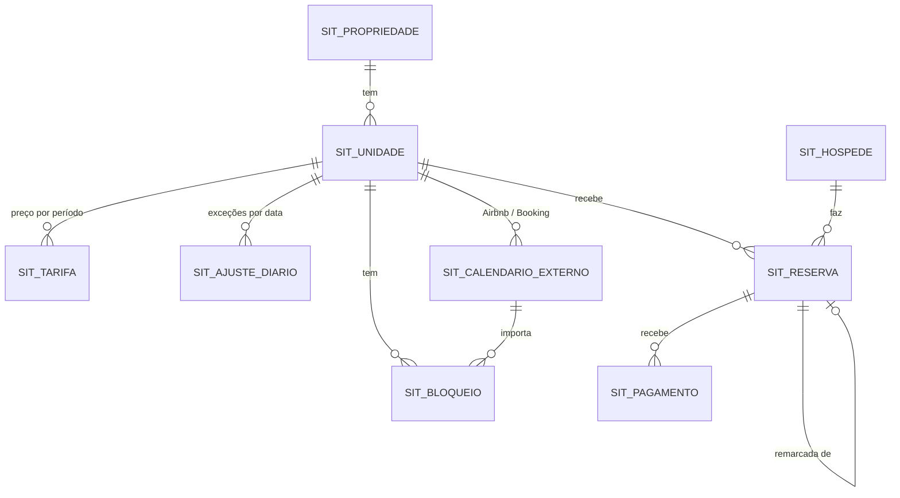

# Banco de dados de reservas — proposta v3 (atualizada em 18/11/2026)

Estrutura para o site responder, ao clicar em **Ver disponibilidade**, se o chalé está livre nas datas escolhidas e quanto custa a estadia, noite a noite.

**Situação:** proposta em validação, ainda não ligada ao site. O schema roda num PostgreSQL 16 e passou em todos os testes desta pasta. Os dados iniciais usam os valores definidos em 16 e 17/11/2026: chalé Casa do Mirante, check-in 15h, R$ 1.700 a noite para o casal, R$ 300 por criança (2 a 13 anos) por noite, bebê não paga mas ocupa vaga, até 2 adultos e 2 crianças, até 7 noites, sinal não reembolsável com remarcação, pagamento por Pix e Mercado Pago, 30 minutos para pagar.

| Arquivo | Conteúdo |
|---|---|
| `schema.sql` | Tabelas, regras, funções e segurança |
| `seed_exemplo.sql` | Dados iniciais reais: a pousada, o chalé e a tarifa padrão |
| `testes.sql` | 54 verificações de preço, bebê, regras de venda, ocupação, pré-reserva, pagamento, remarcação, cancelamento e documento do hóspede (cria os próprios dados de teste) |
| `exemplos_der.sql` / `exemplos_der.json` | Linhas fictícias mostradas no DER, aprovadas por todas as regras |
| `exportar_estrutura.sql` / `exportar_exemplos.sql` / `gerar_der.py` | Extraem a estrutura e os exemplos do banco e geram o `der.html` |
| `testes_permissoes.sql` | O que o visitante anônimo pode e não pode fazer |
| `supabase_simulado.sql` | Recria as permissões padrão do Supabase num PostgreSQL comum, só para os testes |

---

## Por que Supabase

O app de vistorias (`solar-inspect`) já especifica Supabase (PostgreSQL, Auth, RLS, RPC e Edge Functions). Usar o mesmo banco evita duas bases para a mesma pousada, e a proposta reaproveita o modelo **Propriedade → Unidade** de lá. Assim, quando a vistoria bloquear um chalé por manutenção, esse bloqueio pode tirar as datas da venda no site.

O site continua estático no GitHub Pages: ele chama o banco direto pela API do Supabase.

O Supabase roda **PostgreSQL**, não Microsoft SQL Server. Os dois usam a linguagem SQL, mas o schema desta pasta usa recursos próprios do PostgreSQL: intervalos de datas (`daterange`) e a constraint que impede duas reservas na mesma noite. Em SQL Server essas duas partes teriam de ser reescritas com triggers.

## Modelo

Nomes no mesmo padrão dos outros projetos (esquema IBP): tabelas e campos em MAIÚSCULAS. **Toda tabela deste projeto começa com `SIT_`** (de Site), para separar das tabelas de outros projetos que usam o mesmo banco, como o `solar-inspect`, mesmo quando elas se integram. Tabelas no singular e prefixo pelo tipo do campo (`ID_` identificador, `NM_` nome, `DS_` descrição, `DT_` data, `HR_` hora, `VL_` valor, `QTDE_` quantidade, `NO_` número, `CD_` código, `TP_` tipo de lista fixa, `SG_` sim/não). Restrições com o nome completo da tabela: `PK_SIT_RESERVA`, `FK_SIT_RESERVA_SIT_UNIDADE` (`FK_<FILHA>_<PAI>`), `UQ_`, `CK_`, `EX_`, `IX_`, `TG_`. Os campos não levam o prefixo: a chave continua `ID_RESERVA`, `ID_UNIDADE` etc. O PostgreSQL guarda os nomes em minúsculas por dentro, mas aceita escrevê-los em maiúsculas nas consultas.



O diagrama completo, com todos os campos, exemplos e regras de cada tabela, está em `der.html` (abre no navegador; ao clicar numa tabela aparece o detalhe dela).

| Tabela | Para que serve |
|---|---|
| `SIT_PROPRIEDADE` | A pousada: fuso, horários de check-in/out, idade máxima de bebê e de criança, estadia máxima, percentual do sinal, minutos para pagar, regra de remarcação, prazo de arrependimento e versão da política de cancelamento |
| `SIT_UNIDADE` | Cada chalé: capacidade (hóspedes, adultos, crianças + bebês) e taxa de limpeza |
| `SIT_TARIFA` | Preço por período (`DT_INI`/`DT_FIM`): valor da noite, valor de sexta/sábado, adultos inclusos, adulto extra, valor por criança, valor por bebê (R$ 0), mínimo de noites. Períodos podem se sobrepor; vale o maior `NO_PRIORIDADE` |
| `SIT_AJUSTE_DIARIO` | Exceção de um dia (`DT_REF`): preço especial, mínimo de noites, noite fechada, sem chegada ou sem saída. Campo vazio não muda nada; o valor do ajuste substitui só o valor base da noite, e criança e bebê continuam vindo da tarifa (passo a passo no DER) |
| `SIT_RESERVA` | Reservas do site, telefone ou contato direto: adultos, crianças e bebês, preço noite a noite, sinal (pago no site) e saldo (pago no check-in) gravados no momento da reserva, aceite da política, motivo do cancelamento e a reserva original de uma remarcação |
| `SIT_PAGAMENTO` | Tentativas de pagamento de cada parcela (`TP_PARCELA`: SINAL no site, SALDO no check-in): Pix ou cartão via Mercado Pago, ou Pix e dinheiro recebidos na pousada (`MANUAL`). Nenhum dado de cartão é guardado |
| `SIT_BLOQUEIO` | Datas indisponíveis que não são reservas do site: manutenção, uso próprio e reservas do Airbnb/Booking |
| `SIT_CALENDARIO_EXTERNO` | Links iCal do Airbnb e do Booking, importados periodicamente para `SIT_BLOQUEIO` |
| `SIT_HOSPEDE` | Nome, contato e documento da FNRH: CPF para brasileiro; passaporte, país emissor e validade para estrangeiro |

## Como a disponibilidade e o preço são calculados

A estadia são as **noites** de `DT_CHECKIN` até a véspera de `DT_CHECKOUT`. A noite do dia de saída não é cobrada nem ocupada, então quem sai no dia 21 libera o chalé para quem entra no dia 21.

Para cada noite da estadia:

1. **Preço da noite:** o ajuste do dia, se houver. Senão, a tarifa de maior prioridade que cobre a noite: valor de sexta/sábado nas noites de sexta e sábado, valor normal nas demais.
2. **Hóspedes:** o valor da noite cobre os adultos inclusos (o casal). Cada criança de 2 a 13 anos soma o valor de criança por noite, e cada adulto além dos inclusos soma o valor de adulto extra. Bebês abaixo de 2 anos não pagam, mas ocupam uma vaga de criança.
3. **Total:** soma das noites + taxa de limpeza (uma vez por estadia).

A unidade fica **indisponível** quando ocorre qualquer um destes motivos, que voltam para o site mostrar a mensagem certa:

| Motivo | Quando |
|---|---|
| `datas_invalidas` | Check-out igual ou anterior ao check-in |
| `data_passada` | Check-in antes de hoje (fuso de São Paulo) |
| `estadia_longa` | Mais noites que o máximo da propriedade (7) |
| `capacidade` | Mais hóspedes, adultos ou crianças + bebês que o chalé comporta |
| `sem_tarifa` | Alguma noite sem tarifa cadastrada (venda ainda não aberta) |
| `fechado` | Alguma noite marcada como fechada |
| `sem_chegada` / `sem_saida` | Check-in ou check-out numa data que não permite |
| `min_noites` | Menos noites que o mínimo. Vale o **maior** mínimo entre as noites da estadia: quem entra antes do Réveillon e atravessa a virada também cumpre o mínimo do Réveillon |
| `ocupado` | Sobrepõe reserva confirmada, pré-reserva ainda válida ou bloqueio |

## Como o site usa

### 1. Consultar (botão "Ver disponibilidade")

Função pública `consultar_disponibilidade(check-in, check-out, adultos, crianças, bebês)`, chamada direto do navegador:

```js
const resp = await fetch(`${SUPABASE_URL}/rest/v1/rpc/consultar_disponibilidade`, {
  method: 'POST',
  headers: {
    apikey: SUPABASE_ANON_KEY,
    Authorization: `Bearer ${SUPABASE_ANON_KEY}`,
    'Content-Type': 'application/json',
  },
  body: JSON.stringify({ p_checkin: '2027-03-04', p_checkout: '2027-03-07', p_adultos: 2, p_criancas: 1, p_bebes: 0 }),
});
const [chale] = await resp.json();
```

Resposta de exemplo, gerada pelos testes (casal + 1 criança, 3 noites de qui a dom):

```json
{
  "cd_unidade": "casa-do-mirante", "nm_unidade": "Casa do Mirante",
  "disponivel": true, "motivo": null, "qtde_noites": 3, "qtde_min_noites": 1,
  "vl_hospedagem": 6000.00, "vl_taxa_limpeza": 0.00, "vl_total": 6000.00,
  "vl_medio_noite": 2000.00, "vl_sinal": 3000.00,
  "ds_detalhe": [
    { "dt_ref": "2027-03-04", "nm_tarifa": "Tarifa padrão", "vl_base": 1700.00, "vl_extras": 300.00, "vl_noite": 2000.00 },
    { "dt_ref": "2027-03-05", "nm_tarifa": "Tarifa padrão", "vl_base": 1700.00, "vl_extras": 300.00, "vl_noite": 2000.00 },
    { "dt_ref": "2027-03-06", "nm_tarifa": "Tarifa padrão", "vl_base": 1700.00, "vl_extras": 300.00, "vl_noite": 2000.00 }
  ]
}
```

Quando a unidade está indisponível, os valores vêm vazios e `motivo` explica o porquê. A API devolve os nomes em minúsculas (é assim que o PostgreSQL os guarda). A chave `anon` do Supabase é pública por natureza; a proteção está no banco (ver Segurança).

### 2. Reservar

`criar_pre_reserva(unidade, check-in, check-out, adultos, crianças, bebês)` segura as datas por **30 minutos** enquanto o hóspede paga o **sinal** (50% do total), e devolve o código da reserva (ex.: `SE-7F3A2C1D`), o total e o sinal. Ela é chamada por uma **Edge Function** do Supabase, nunca direto do navegador, para que a função possa aplicar captcha e limite de tentativas antes de segurar datas. O pagamento é feito pelo Mercado Pago (Pix ou cartão) e registrado em `SIT_PAGAMENTO`; quando o Mercado Pago avisa a aprovação (webhook), a Edge Function grava o hóspede, com o documento (CPF do brasileiro ou passaporte do estrangeiro) e o aceite da política, e muda a reserva para `CONFIRMADA`. O banco recusa a confirmação se o passaporte do estrangeiro vencer antes do dia da saída.

Se o pagamento não acontecer, a pré-reserva vence sozinha: a consulta já ignora pré-reservas vencidas, e um job (`expirar_pre_reservas`, via pg_cron) só atualiza o status.

### 3. Airbnb e Booking

O chalé também é vendido nesses canais, então os três calendários precisam conversar:

- **Entrada:** um job (Edge Function agendada, a cada 15–30 min) lê o iCal de cada canal em `SIT_CALENDARIO_EXTERNO` e grava as datas em `SIT_BLOQUEIO`. O UID de cada evento permite atualizar ou remover o bloqueio quando o canal cancela.
- **Saída:** o site publica o próprio iCal (reservas confirmadas + bloqueios manuais) para ser importado no Airbnb e no Booking.

O iCal tem atraso de minutos a horas, então ainda existe um risco pequeno de vender a mesma data em dois canais nesse intervalo. Eliminar esse risco por completo exige um channel manager (integração por API).

## Garantias contra overbooking

- **No banco:** uma constraint impede duas reservas ativas do mesmo chalé na mesma noite, mesmo com acessos simultâneos.
- **Na pré-reserva:** a função trava o chalé durante a verificação, então pedidos simultâneos entram em fila. Testado com duas sessões ao mesmo tempo: a segunda esperou a primeira e foi recusada com `ocupado`.
- **Bloqueios fora da constraint:** ficam de fora de propósito, porque o iCal de um canal costuma devolver também as datas que o próprio site vendeu, e isso não pode quebrar a sincronização. A trava da pré-reserva cobre esse caso.

## Segurança

- **RLS em todas as tabelas,** sem nenhuma política para visitante: o navegador não lê nem grava tabela alguma. Testado como `anon`: 0 linhas em `SIT_RESERVA`, `SIT_HOSPEDE` e `SIT_PAGAMENTO`, inserção recusada.
- **Uma única porta para o visitante:** `consultar_disponibilidade`, que não devolve dados de hóspedes nem de outras reservas.
- **Revogação explícita:** no Supabase as funções novas recebem permissão de execução para `anon` e `authenticated` por padrão, então o schema revoga essa permissão papel a papel. A pré-reserva e a função interna de cálculo só rodam com `service_role`.
- **Equipe:** as políticas de acesso do painel (para cadastrar tarifas e ver reservas) entram junto com o login do Supabase, no mesmo modelo de perfis do `solar-inspect`.

## Decisões

Definidas em 16 e 17/11/2026 e já aplicadas: chalé Casa do Mirante; check-in às 15h e check-out às 12h; R$ 1.700 a noite para o casal; R$ 300 por criança (2 a 13 anos) por noite; adulto a partir de 14 anos; bebê até 1 ano não paga (`SIT_TARIFA.VL_BEBE` = 0, idade em `SIT_PROPRIEDADE.NO_IDADE_MAX_BEBE`), mas ocupa uma das 2 vagas de criança (`SIT_RESERVA.QTDE_BEBES` soma com as crianças contra `SIT_UNIDADE.QTDE_MAX_CRIANCAS`); até 2 adultos e 2 crianças; sem taxa de limpeza; até 7 noites; datas especiais com mínimo de 2 noites; sinal de 50% pago no site (Pix ou Mercado Pago), não reembolsável, com possibilidade de remarcação; saldo pago no check-in, antes de entrar, por Pix ou dinheiro; 30 minutos para pagar o sinal; aceite da política e motivo do cancelamento registrados em cada reserva; prazo de arrependimento de 7 dias (CDC art. 49).

Proposta aguardando aprovação: remarcar até 7 dias antes do check-in (`QTDE_DIAS_LIMITE_REMARCACAO`), crédito válido por 12 meses (`QTDE_MESES_VALIDADE_CREDITO`), diferença paga se a nova data for mais cara e não devolvida se for mais barata.

Propostas aguardando aprovação (detalhadas no dicionário de dados, com fontes): política de cancelamento (devolução integral em até 7 dias da reserva, remarcação sem custo com 7+ dias de antecedência, retenção do sinal ou de 20% do total na desistência sem remarcar) e tarifa dinâmica por regras (fator por tipo de data, desconto de antecedência, piso e teto; tabelas TIPO_DATA, DATA_ESPECIAL e REGRA_ANTECEDENCIA ainda não criadas).

Documento do hóspede (18/11/2026): a FNRH digital é obrigatória desde 20/04/2026 e pede o documento de cada hóspede. `SIT_HOSPEDE` ganhou `SG_NACIONALIDADE` (padrão BR), `CD_CPF`, `CD_PASSAPORTE`, `SG_PAIS_PASSAPORTE`, `DT_EMISSAO_PASSAPORTE` (opcional) e `DT_VALIDADE_PASSAPORTE`. Brasileiro exige CPF válido (dígitos verificadores conferidos pela função `cpf_valido`); estrangeiro exige passaporte com o país emissor e a validade (depois da emissão). O gatilho `TG_SIT_RESERVA_PASSAPORTE` recusa reserva ativa de estrangeiro cujo passaporte vence antes da saída. CPF único; passaporte único por país. O CPF **não** é a chave: `ID_HOSPEDE` continua como número interno, porque estrangeiro não tem CPF, a pré-reserva nasce antes do documento e a chave é copiada para outras tabelas (LGPD). O documento é exigido quando o hóspede é cadastrado, isto é, no fechamento da reserva.

Diagrama: `der.html` nesta pasta (abre no navegador). Para gerar de novo depois de mudar o schema:

```bash
psql -d solar -v ON_ERROR_STOP=1 -f exemplos_der.sql
```

```bash
psql -d solar -At -f exportar_estrutura.sql > schema.json
```

```bash
psql -d solar -At -f exportar_exemplos.sql > exemplos_der.json
```

```bash
python3 gerar_der.py schema.json der.html exemplos_der.json --completo
```

Use um banco de teste: `exemplos_der.sql` grava dados fictícios. O `gerar_der.py` confere se as ligações do desenho são as FKs reais e se cada campo tem explicação e exemplo.

## Como testar localmente

Com PostgreSQL 15+ e um banco vazio:

```bash
psql -d solar -v ON_ERROR_STOP=1 -f supabase_simulado.sql -f schema.sql -f seed_exemplo.sql
```

```bash
psql -d solar -v ON_ERROR_STOP=1 -f testes.sql -f testes_permissoes.sql
```

Cada cenário imprime `ok` ou interrompe com `FALHOU` mostrando o valor obtido e o esperado.

## Como aplicar no Supabase

1. No painel do projeto, abra **SQL Editor › New query**.
2. Cole o conteúdo de `schema.sql` e clique em **Run**.
3. Opcional: rode `seed_exemplo.sql` para ter os dados iniciais e, num projeto de teste, `testes.sql` ou `exemplos_der.sql`.
4. Para expirar pré-reservas automaticamente, ative a extensão **pg_cron** (Database › Extensions) e rode:
   `select cron.schedule('expirar-pre-reservas', '* * * * *', 'select expirar_pre_reservas()');`

Não rode `supabase_simulado.sql` no Supabase: os papéis `anon`, `authenticated` e `service_role` já existem lá.

## Próximos passos sugeridos

1. Fechar as decisões em aberto e substituir os dados de exemplo.
2. Criar o projeto no Supabase (ou usar o do `solar-inspect`) e aplicar o schema.
3. Ligar o botão "Ver disponibilidade" do site à consulta e mostrar preço ou motivo.
4. Edge Functions: pré-reserva + pagamento, importação dos iCal, exportação do iCal do site.
5. Painel da equipe para tarifas, ajustes e reservas.
6. Envio da FNRH digital ao Ministério do Turismo a partir do cadastro do hóspede.
